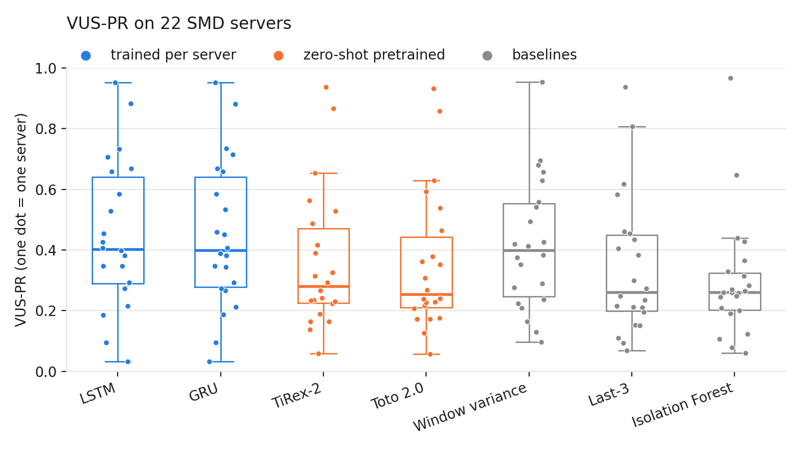
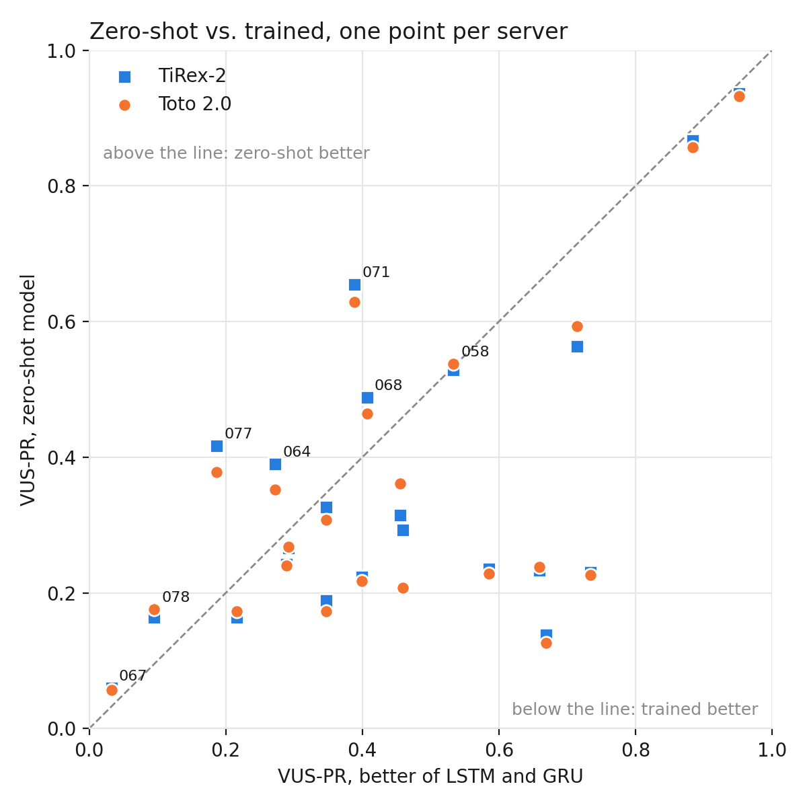
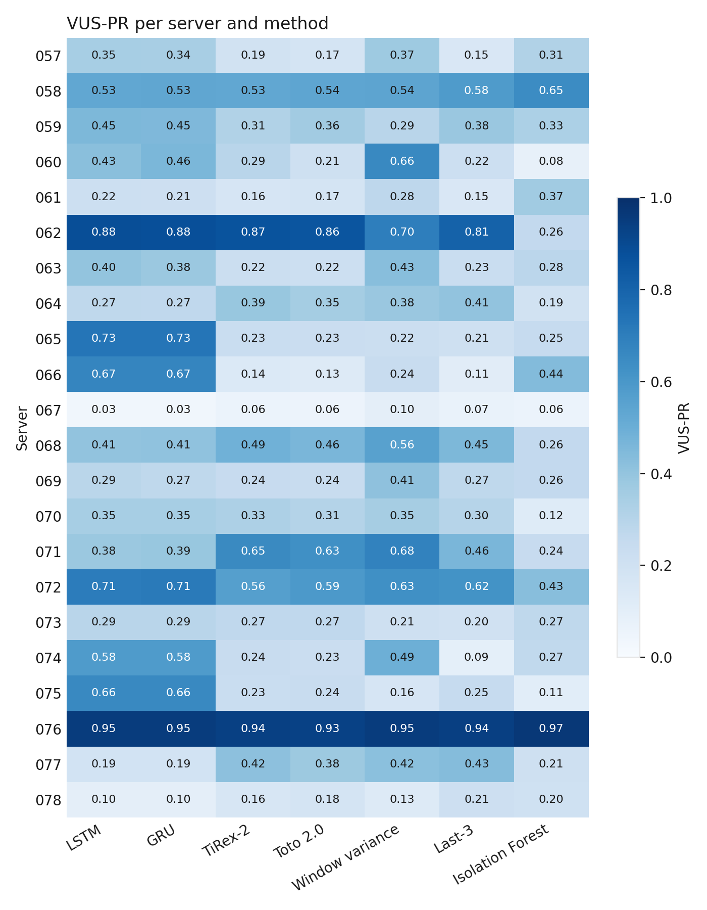

# Results on all 22 servers

## What changed since the pilot

The pilot used one server and only simple methods. Now every method runs on all 22 SMD servers, and four new models are added: LSTM and GRU trained separately for each server, and the pretrained TiRex-2 and Toto 2.0 used without any training.

## Data

The data is the same as in the pilot: 22 servers from the TSB-AD version of SMD, 38 metrics per minute. The training parts are short, between 500 and 7,180 minutes, while the test parts are between about 17,800 and 27,700 minutes long. All metrics are brought to the same scale using the mean and standard deviation of the training part only.

## Methods

Last-3, moving-window variance and Isolation Forest work as in the pilot. The variance window is no longer fixed at 30 minutes. TSB-AD chooses it for each server from the typical period of the first metric, and it was 30 on the pilot server. Isolation Forest is again run with five random seeds.

LSTM is the TSB-AD implementation. It looks at the last 100 minutes and predicts the values of all 38 metrics in the next minute. It is trained on the training part of the same server only, and part of that data is held out to stop training once the model no longer improves. The score of a minute is the prediction error: the squared difference between the predicted and the real value, averaged over the 38 metrics. We trained it with three random seeds.

GRU is the same model with the two LSTM layers replaced by GRU layers of the same size. TSB-AD has no GRU, so we copied its LSTM model and changed only the layer type. Window, forecast length, training settings and the score are the same as for LSTM, also with three random seeds.

TiRex-2 is a pretrained forecasting model, and its weights are not changed. It receives up to 512 previous minutes and forecasts the next 10 minutes, then moves 10 minutes forward and forecasts again. At the start of a series it gets as much history as exists. The model gives a range of possible values, and we take the middle one (the median). The score is computed in the same way as for LSTM: the squared error of the forecast, averaged over the 38 metrics. We keep the error of every metric separately, so other ways of combining them can be tested without running the model again.

Toto 2.0 is used in the same way as TiRex-2: up to 512 previous minutes, a 10-minute forecast, a step of 10 minutes, all 38 metrics given to the model together, the median forecast and the same score. We use the checkpoint `Datadog/Toto-2.0-313m` (312,684,608 parameters). Toto splits the history into patches of 32 minutes, so at the start of a series, where less than 512 minutes exist, the history is padded on the left and the padding is marked as missing.

## Evaluation

As in the pilot, the main measure is VUS-PR on the test part, and F1 is taken at the best threshold on the test part, so it is optimistic. For each method we report the mean and the median over the 22 servers, on how many servers it was the best, and its average place among the seven methods (1 is best, 7 is worst). For methods with several seeds, we first average the seeds on each server.

## Results

| Method | Mean VUS-PR | Median VUS-PR | Best on | Average place | Mean F1 | Time per server |
|---|---|---|---|---|---|---|
| LSTM (3 seeds) | 0.448 | 0.402 | 5 | 3.25 | 0.505 | 8 s with training, laptop GPU |
| GRU (3 seeds) | 0.448 | 0.398 | 3 | 3.43 | 0.507 | 112 s with training, laptop CPU |
| Moving-window variance | 0.418 | 0.398 | 8 | 3.00 | 0.482 | below 0.01 s |
| TiRex-2 | 0.360 | 0.280 | 0 | 4.50 | 0.386 | about 6 min, one V100 GPU |
| Toto 2.0 | 0.352 | 0.254 | 0 | 4.86 | 0.379 | 84-117 s, one V100 GPU |
| Last-3 | 0.343 | 0.260 | 3 | 4.41 | 0.393 | below 0.01 s |
| Isolation Forest (5 seeds) | 0.298 | 0.260 | 3 | 4.55 | 0.453 | 3 s, CPU |

In this figure each pretrained model is compared with the better of LSTM and GRU on the same server. Taking the better of two trained models slightly favours them. The effect is small, because LSTM and GRU differ by less than 0.01 on 19 of the 22 servers, so the picture would be almost the same with either of them alone.

LSTM and GRU have the highest mean, and they are almost equal: GRU scored higher than LSTM on 8 of the 22 servers, and on any server the two differ by at most 0.034. The moving-window variance is close behind them, wins on the most servers and has the best average place. It needs no training and is computed almost instantly.

Neither pretrained model reached them. TiRex-2 and Toto 2.0 have similar means (0.360 and 0.352), Toto scored higher than TiRex-2 on 7 of the 22 servers, and on a server the two differ by 0.018 on average. So pretraining on observability data did not give Toto an advantage on SMD. TiRex-2 scored higher than the better of LSTM and GRU on 6 servers (064, 067, 068, 071, 077, 078), Toto on the same 6 and on 058, but neither was the best method on any server.

The times are not directly comparable: LSTM ran on a laptop GPU, GRU on a different laptop without a GPU, and the pretrained models on Ares, where the 22 servers ran in parallel. On a laptop GPU TiRex-2 took about an hour per server.

The servers differ a lot. On one server all methods score about 0.95, on another all of them stay below 0.1. An average over 22 servers hides this, so the per-server results are given below.

LSTM and GRU give almost the same result with every seed: on a server, the best and the worst seed differ by 0.009 on average for LSTM and 0.005 for GRU. For Isolation Forest the difference is larger, 0.058.

## Mean or maximum over the metrics

A mean over 38 metrics could hide an anomaly that shows up in only one of them. We therefore also tried the largest error among the 38 metrics instead of the mean. It made every method slightly worse:

| Method | Mean over metrics | Maximum over metrics | Servers where the maximum is better |
|---|---|---|---|
| TiRex-2 | 0.360 | 0.344 | 3 of 22 |
| Moving-window variance | 0.418 | 0.404 | 4 of 22 |
| Last-3 | 0.343 | 0.333 | 6 of 22 |

This was not yet computed for Toto 2.0. In SMD an anomaly usually affects several metrics at once, so the mean picks it up better, while the maximum also reacts to a jump in a single noisy metric. We keep the mean. The weaker result of TiRex-2 does not come from the way the metrics are combined.

## Results per server (VUS-PR)

## Comparison with earlier work

| Paper | What they found | What we see |
|---|---|---|
| Zhu et al. (ICLR 2026) | Pretrained models are not better than one-line baselines such as the moving-window variance | The same, with newer models and 38 metrics instead of one: the variance is ahead of both TiRex-2 and Toto 2.0 |
| Yum (2026) | A simple baseline beat Toto on TSB-AD-M (0.29 vs. 0.14) | The same direction. The numbers cannot be compared directly: he used all datasets of TSB-AD-M and his scores could use future values, we use SMD only and score online |
| Qiu et al. (TAB, PVLDB 2025) | Trained models beat pretrained ones used without training, no method is the best everywhere, simple methods are among the strongest | All three hold. The best method changes from server to server |
| Sengupta et al. (2026) | A small model almost matches a large pretrained one at a much lower cost | A small LSTM is better than pretrained models with hundreds of millions of parameters |
| Olive et al. (2026) | The first Toto is slow, 123 s per 1,000 points | Different: Toto 2.0 took about 4 s per 1,000 points on one V100 and was faster than TiRex-2. They used an older model version and other hardware, so this is not a contradiction |

New in our results:

| Result | Why it matters |
|---|---|
| TiRex-2 performs at the level of Toto 2.0 | In our search we found no earlier evaluation of TiRex-2 for anomaly detection |
| Toto 2.0 is not better than TiRex-2 on SMD | Toto was pretrained on observability data, close to server metrics, but this gave it no advantage |
| Both pretrained models beat the trained ones on the same six servers | Whether a pretrained model pays off seems to depend more on the server than on the model |

We have not yet checked whether SMD was part of the pretraining data of either model.

## Limitations

F1 still uses a threshold chosen on the test part. A threshold taken from the training part, and the number of false alarms it produces, are the next step.

LSTM and GRU predict one minute ahead, TiRex-2 and Toto 2.0 ten minutes ahead. The comparison is therefore not yet made at the same forecast horizon.

TiRex-2 and Toto 2.0 were run with one setting only: 512 minutes of history and a 10-minute forecast. Toto was run in one model size (313M).

Isolation Forest is still fitted on the whole series, including the test part.

We have not yet checked whether SMD was part of the data TiRex-2 and Toto 2.0 were trained on. If it was, their results here are not fully zero-shot.

## What this means for the plan

LSTM and GRU trained on the full history are better than TiRex-2 and Toto 2.0. The cold-start experiment will show whether this still holds when LSTM gets only a little history. Because the moving-window variance also needs no training and is better than both pretrained models, LSTM and GRU with little history should be compared with all three.

The training parts are short, so the amounts of history for the cold start are better given in minutes than in percent. With 10% of the shortest training part, LSTM would get 50 minutes, less than the 100 it looks at.

Next come the cold start and the threshold from the training part with the false alarms.
