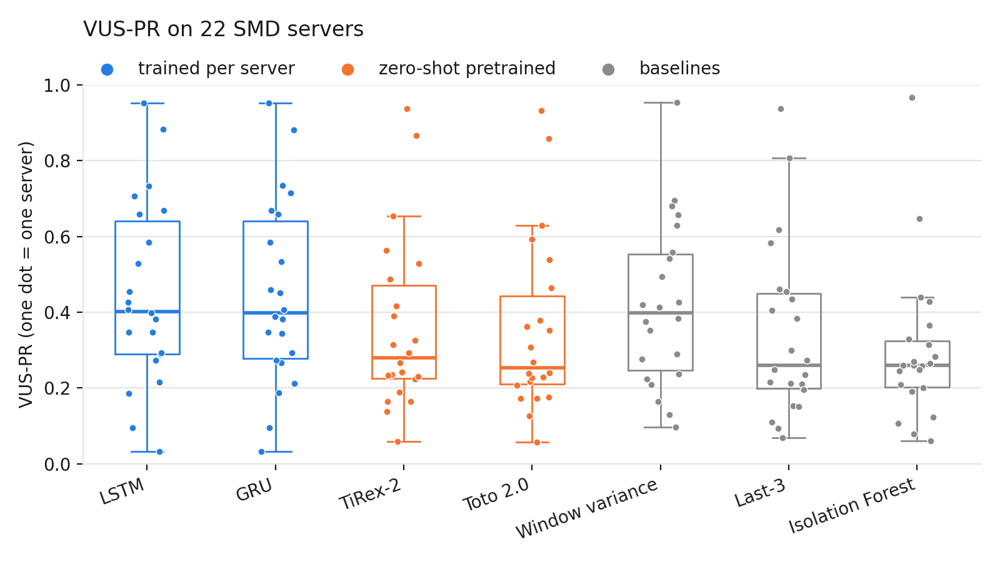
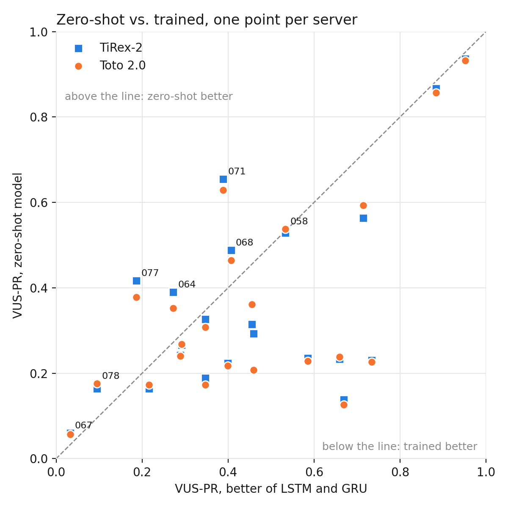
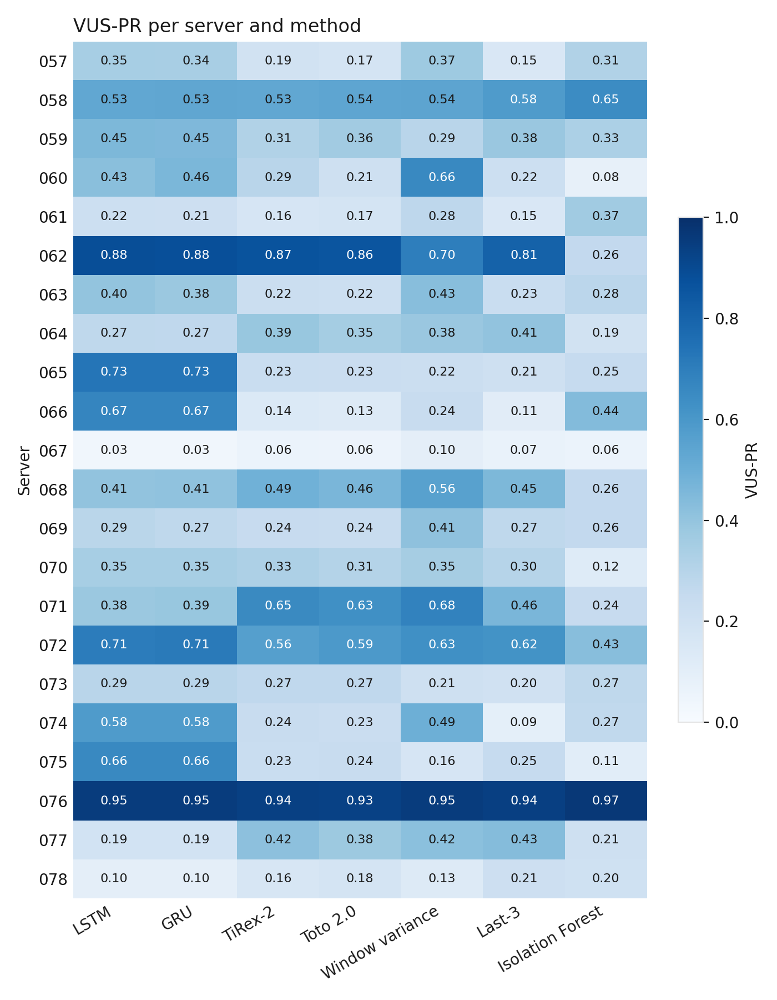

# Wyniki na wszystkich 22 serwerach

## Co się zmieniło od pilotażu

Pilotaż obejmował jeden serwer i tylko proste metody. Teraz każda metoda działa na wszystkich 22 serwerach SMD i dochodzą cztery nowe modele: LSTM i GRU trenowane osobno dla każdego serwera oraz wstępnie wytrenowane modele TiRex-2 i Toto 2.0, używane bez żadnego trenowania.

## Dane

Dane są takie same jak w pilotażu: 22 serwery z wersji SMD przygotowanej w TSB-AD, 38 metryk na minutę. Części treningowe są krótkie, od 500 do 7 180 minut, a części testowe mają od około 17 800 do 27 700 minut. Wszystkie metryki sprowadzamy do tej samej skali, używając średniej i odchylenia standardowego wyłącznie z części treningowej.

## Metody

Last-3, wariancja w oknie przesuwnym i Isolation Forest działają tak jak w pilotażu. Okno wariancji nie jest już stałe i równe 30 minutom. TSB-AD dobiera je dla każdego serwera na podstawie typowego okresu pierwszej metryki, a na serwerze z pilotażu wynosiło ono 30. Isolation Forest ponownie uruchamiamy z pięcioma ziarnami losowymi.

LSTM to rekurencyjna sieć neuronowa w implementacji z biblioteki TSB-AD. Patrzy na ostatnie 100 minut i przewiduje wartości wszystkich 38 metryk w następnej minucie. Jest trenowana wyłącznie na części treningowej tego samego serwera, a część tych danych odkładamy, żeby zatrzymać trening, gdy model przestaje się poprawiać. Ocena minuty to błąd predykcji: kwadrat różnicy między wartością przewidzianą a rzeczywistą, uśredniony po 38 metrykach. Trenowaliśmy ją z trzema ziarnami losowymi.

GRU to ten sam model, w którym dwie warstwy LSTM zastąpiono warstwami GRU tej samej wielkości. TSB-AD nie zawiera GRU, więc skopiowaliśmy jego model LSTM i zmieniliśmy tylko typ warstwy. Okno, długość predykcji, ustawienia treningu i ocena są takie same jak dla LSTM, również z trzema ziarnami losowymi.

TiRex-2 to wstępnie wytrenowany model prognozujący, którego wag nie zmieniamy. Dostaje do 512 poprzednich minut i prognozuje następne 10 minut, potem przesuwa się o 10 minut do przodu i prognozuje ponownie. Na początku szeregu dostaje tyle historii, ile jest dostępne. Model podaje zakres możliwych wartości, a my bierzemy wartość środkową (medianę). Ocenę liczymy tak samo jak dla LSTM: kwadrat błędu prognozy uśredniony po 38 metrykach. Błąd każdej metryki zapisujemy osobno, więc inne sposoby ich łączenia można sprawdzić bez ponownego uruchamiania modelu.

Toto 2.0 używamy tak samo jak TiRex-2: do 512 poprzednich minut, prognoza na 10 minut, krok 10 minut, wszystkie 38 metryk podane modelowi razem, mediana prognozy i ta sama ocena. Używamy wersji `Datadog/Toto-2.0-313m` (312 684 608 parametrów). Toto dzieli historię na fragmenty po 32 minuty, więc na początku szeregu, gdzie jest mniej niż 512 minut, historia jest uzupełniana z lewej strony, a uzupełnienie jest oznaczone jako brakujące dane.

## Ocena

Tak jak w pilotażu główną miarą jest VUS-PR na części testowej, a F1 liczymy przy najlepszym progu na części testowej, więc jest ono optymistyczne. Dla każdej metody podajemy średnią i medianę z 22 serwerów, na ilu serwerach była najlepsza oraz jej średnie miejsce wśród siedmiu metod (1 to najlepsze, 7 najgorsze). Dla metod z kilkoma ziarnami najpierw uśredniamy ziarna na każdym serwerze.

## Wyniki

| Metoda | Średnie VUS-PR | Mediana VUS-PR | Najlepsza na | Średnie miejsce | Średnie F1 | Czas na serwer |
|---|---|---|---|---|---|---|
| LSTM (3 ziarna) | 0,448 | 0,402 | 5 | 3,25 | 0,505 | 8 s z treningiem, GPU laptopa |
| GRU (3 ziarna) | 0,448 | 0,398 | 3 | 3,43 | 0,507 | 112 s z treningiem, CPU laptopa |
| Wariancja w oknie | 0,418 | 0,398 | 8 | 3,00 | 0,482 | poniżej 0,01 s |
| TiRex-2 | 0,360 | 0,280 | 0 | 4,50 | 0,386 | około 6 min, jedna karta V100 |
| Toto 2.0 | 0,352 | 0,254 | 0 | 4,86 | 0,379 | 84-117 s, jedna karta V100 |
| Last-3 | 0,343 | 0,260 | 3 | 4,41 | 0,393 | poniżej 0,01 s |
| Isolation Forest (5 ziaren) | 0,298 | 0,260 | 3 | 4,55 | 0,453 | 3 s, CPU |

Na tym wykresie każdy model wstępnie wytrenowany porównujemy z lepszym z LSTM i GRU na tym samym serwerze. Wybór lepszego z dwóch modeli trenowanych lekko je faworyzuje. Efekt jest mały, bo LSTM i GRU różnią się o mniej niż 0,01 na 19 z 22 serwerów, więc z każdym z nich osobno obraz byłby prawie taki sam.

LSTM i GRU mają najwyższą średnią i są prawie równe: GRU wypadł lepiej niż LSTM na 8 z 22 serwerów, a na żadnym serwerze nie różnią się o więcej niż 0,034. Wariancja w oknie jest tuż za nimi, wygrywa na największej liczbie serwerów i ma najlepsze średnie miejsce. Nie wymaga trenowania i liczy się niemal natychmiast.

Żaden model wstępnie wytrenowany ich nie dogonił. TiRex-2 i Toto 2.0 mają podobne średnie (0,360 i 0,352), Toto wypadł lepiej niż TiRex-2 na 7 z 22 serwerów, a na jednym serwerze różnią się średnio o 0,018. Wstępne trenowanie na danych z monitoringu systemów nie dało więc Toto przewagi na SMD. TiRex-2 wypadł lepiej niż lepszy z LSTM i GRU na 6 serwerach (064, 067, 068, 071, 077, 078), Toto na tych samych 6 i na 058, ale żaden z nich nie był najlepszą metodą na żadnym serwerze.

Czasów nie da się porównać wprost: LSTM liczył się na GPU laptopa, GRU na innym laptopie bez GPU, a modele wstępnie wytrenowane na klastrze Ares, gdzie 22 serwery liczyły się równolegle. Na GPU laptopa TiRex-2 potrzebował około godziny na serwer.

Serwery bardzo się różnią. Na jednym wszystkie metody osiągają około 0,95, na innym wszystkie zostają poniżej 0,1. Średnia z 22 serwerów to ukrywa, dlatego wyniki dla poszczególnych serwerów podajemy niżej.

LSTM i GRU dają prawie ten sam wynik dla każdego ziarna: na jednym serwerze najlepsze i najgorsze ziarno różnią się średnio o 0,009 dla LSTM i 0,005 dla GRU. Dla Isolation Forest różnica jest większa, 0,058.

## Średnia czy maksimum po metrykach

Średnia z 38 metryk mogłaby ukryć anomalię widoczną tylko w jednej z nich. Dlatego sprawdziliśmy też największy błąd spośród 38 metryk zamiast średniej. Każda metoda wypadła wtedy nieco gorzej:

| Metoda | Średnia po metrykach | Maksimum po metrykach | Serwery, na których maksimum jest lepsze |
|---|---|---|---|
| TiRex-2 | 0,360 | 0,344 | 3 z 22 |
| Wariancja w oknie | 0,418 | 0,404 | 4 z 22 |
| Last-3 | 0,343 | 0,333 | 6 z 22 |

Dla Toto 2.0 tego jeszcze nie policzyliśmy. W SMD anomalia zwykle dotyczy kilku metryk naraz, więc średnia lepiej ją wychwytuje, a maksimum reaguje też na skok w jednej zaszumionej metryce. Zostajemy przy średniej. Słabszy wynik TiRex-2 nie wynika ze sposobu łączenia metryk.

## Wyniki dla poszczególnych serwerów (VUS-PR)

## Porównanie z wcześniejszymi pracami

| Praca | Co ustalili autorzy | Co widzimy my |
|---|---|---|
| Zhu i in. (ICLR 2026) | Modele wstępnie wytrenowane nie są lepsze od jednolinijkowych metod bazowych, takich jak wariancja w oknie | To samo, z nowszymi modelami i 38 metrykami zamiast jednej: wariancja wyprzedza zarówno TiRex-2, jak i Toto 2.0 |
| Yum (2026) | Prosta metoda bazowa pokonała Toto na TSB-AD-M (0,29 wobec 0,14) | Ten sam kierunek. Liczb nie da się porównać wprost: autor używał wszystkich zbiorów TSB-AD-M, a jego oceny mogły korzystać z przyszłych wartości, my używamy tylko SMD i liczymy online |
| Qiu i in. (TAB, PVLDB 2025) | Modele trenowane wygrywają z wstępnie wytrenowanymi używanymi bez trenowania, żadna metoda nie jest najlepsza wszędzie, proste metody są wśród najmocniejszych | Wszystkie trzy wnioski się potwierdzają. Najlepsza metoda zmienia się od serwera do serwera |
| Sengupta i in. (2026) | Mały model prawie dorównuje dużemu wstępnie wytrenowanemu przy znacznie niższym koszcie | Mała sieć LSTM jest lepsza od modeli wstępnie wytrenowanych z setkami milionów parametrów |
| Olive i in. (2026) | Pierwsza wersja Toto jest wolna, 123 s na 1 000 punktów | Inaczej: Toto 2.0 potrzebował około 4 s na 1 000 punktów na jednej karcie V100 i był szybszy niż TiRex-2. Autorzy używali starszej wersji modelu i innego sprzętu, więc to nie jest sprzeczność |

Nowe w naszych wynikach:

| Wynik | Dlaczego to ważne |
|---|---|
| TiRex-2 działa na poziomie Toto 2.0 | W naszym przeglądzie nie znaleźliśmy wcześniejszej oceny TiRex-2 w wykrywaniu anomalii |
| Toto 2.0 nie jest lepszy od TiRex-2 na SMD | Toto był wstępnie trenowany na danych z monitoringu systemów, bliskich metrykom serwerów, ale nie dało mu to przewagi |
| Oba modele wstępnie wytrenowane wygrywają z trenowanymi na tych samych sześciu serwerach | To, czy model wstępnie wytrenowany się opłaca, wydaje się zależeć bardziej od serwera niż od modelu |

Nie sprawdziliśmy jeszcze, czy SMD był częścią danych, na których wstępnie trenowano któryś z tych modeli.

## Ograniczenia

F1 nadal korzysta z progu wybranego na części testowej. Następnym krokiem jest próg wyznaczony na części treningowej i liczba fałszywych alarmów, które daje.

LSTM i GRU przewidują jedną minutę do przodu, TiRex-2 i Toto 2.0 dziesięć minut. Porównanie nie jest więc jeszcze wykonane przy tym samym horyzoncie prognozy.

TiRex-2 i Toto 2.0 uruchomiliśmy tylko z jednym ustawieniem: 512 minut historii i prognoza na 10 minut. Toto sprawdziliśmy w jednym rozmiarze (313M).

Isolation Forest jest nadal dopasowywany do całego szeregu, łącznie z częścią testową.

Nie sprawdziliśmy jeszcze, czy SMD był częścią danych, na których trenowano TiRex-2 i Toto 2.0. Jeśli tak, ich wyniki nie są w pełni zero-shot.

## Co to oznacza dla planu

LSTM i GRU trenowane na pełnej historii są lepsze niż TiRex-2 i Toto 2.0. Eksperyment zimnego startu pokaże, czy tak zostaje, gdy LSTM dostaje tylko niewiele historii. Ponieważ wariancja w oknie również nie wymaga trenowania i jest lepsza od obu modeli wstępnie wytrenowanych, LSTM i GRU z małą historią trzeba porównać ze wszystkimi trzema.

Części treningowe są krótkie, więc ilość historii w zimnym starcie lepiej podawać w minutach niż w procentach. Przy 10% najkrótszej części treningowej LSTM dostałby 50 minut, mniej niż 100, na które patrzy.

Dalej zimny start oraz próg z części treningowej wraz z fałszywymi alarmami.
